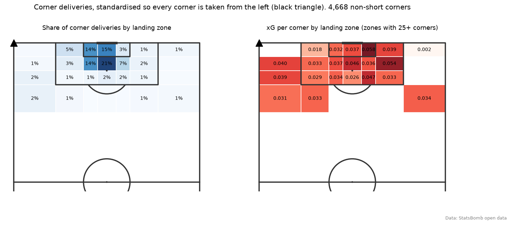
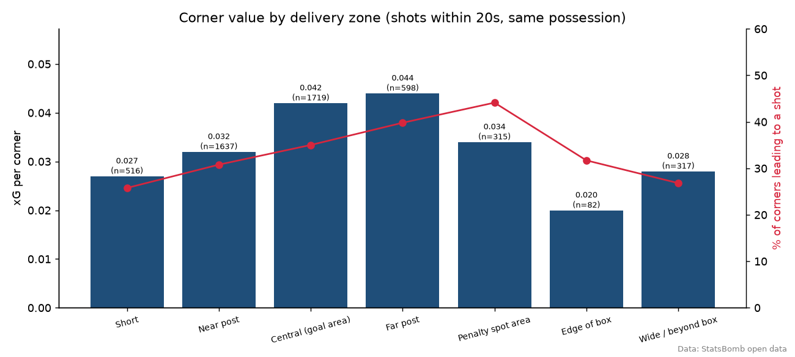
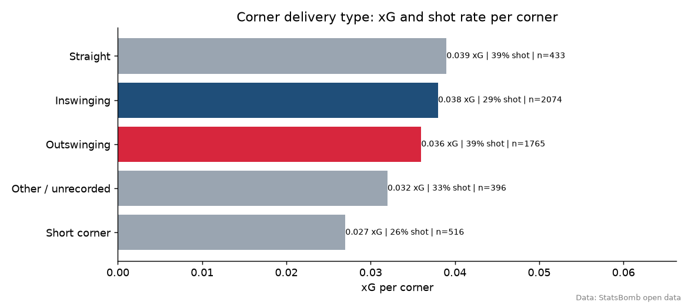
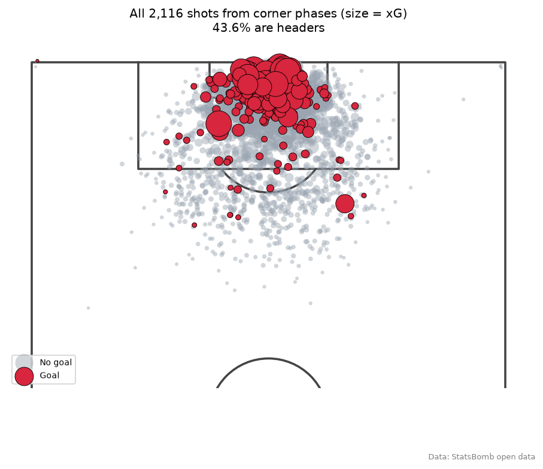
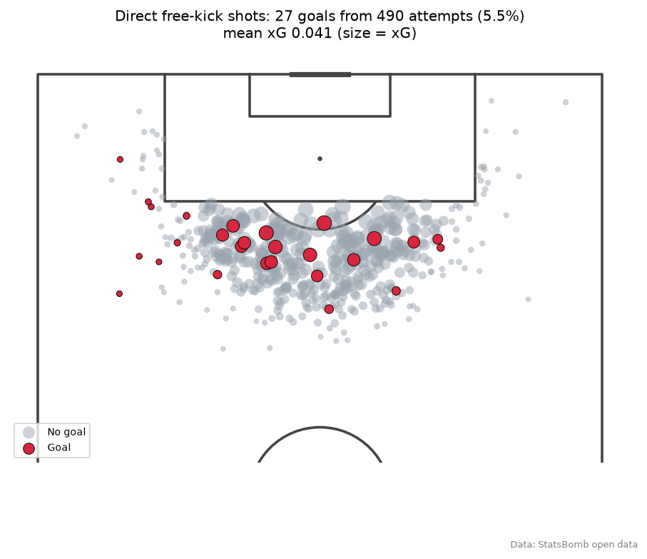
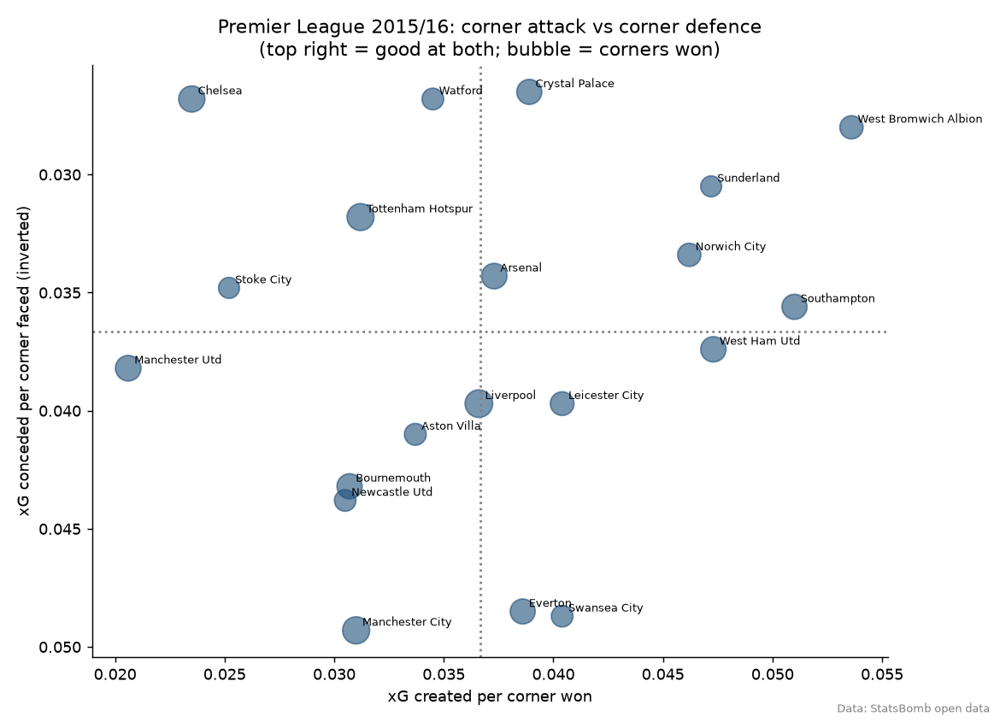
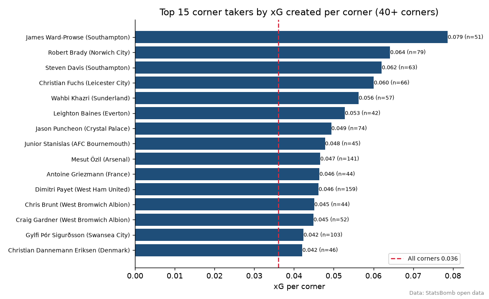
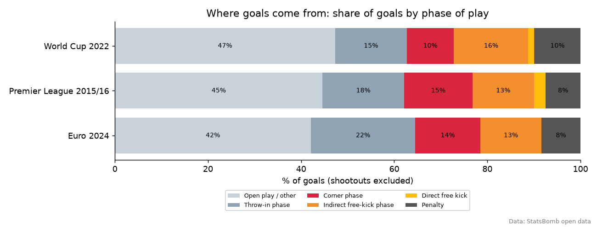

# Set-piece analysis: what makes a corner or free kick dangerous?


An analysis of **5,184 corners and 2,415 attacking free kicks** from **495 matches** of StatsBomb open event data
(Premier League 2015/16, FIFA World Cup 2022 and UEFA Euro 2024). I measure how often each set piece leads to a shot,
the xG it produces and which delivery types, target zones, teams and takers create the most. The project includes
statistical tests, a logistic regression, mplsoccer pitch charts and an interactive Streamlit dashboard.

Author: Anthony Adusei-Poku ([@anthony07-max](https://github.com/anthony07-max))



## Key findings

| All 495 matches | Value |
|---|---|
| Corners per match | 10.5 |
| Corners leading to a shot (within 20 s) | **33.3%** |
| xG per corner | **0.036** |
| Goals from corners | 162 (one every **32** corners) |
| Set pieces' share of non-penalty goals | **32.2%** (corners alone 15.2%) |

1. **About a third of non-penalty goals come from set pieces.** Corner phases, indirect free-kick phases and direct free kicks
   account for 32.8% of non-penalty goals in the 2015/16 Premier League, 30.3% at the 2022 World Cup and 29.6% at Euro 2024.
2. **An average corner is worth about 0.036 xG.** That is roughly one goal every 32 corners. Only one corner in three leads
   to a shot within 20 seconds.
3. **Aim beyond the near post.** Deliveries to the far post produce 0.044 xG per corner and a shot 39.8% of the time.
   Near-post deliveries produce 0.032 xG and a shot 30.8% of the time. In a logistic regression controlling for swing and
   competition, a far-post delivery has **1.48x the odds of producing a shot** compared with the near post (p = 0.0001).
   For the penalty-spot area the figure is 1.39x (p = 0.014). Short corners are the least productive (0.027 xG, 25.8% shot rate).
4. **Outswingers win the first contact, inswingers create slightly better chances.** Outswinging corners lead to a shot
   38.9% of the time against 29.1% for inswingers (chi-square p < 0.0001). The attacking team wins the first contact on 39.2% of outswingers
   and 23.4% of inswingers. The model odds ratio for an outswinger is 1.56 (p < 0.001). Per corner, though, inswingers produce
   slightly more xG (0.039 vs 0.036). Fewer of them reach a shot, but the shots they create are better.
5. **Headers are 43.6% of corner-phase shots.** They convert at 7.8%, against 8.8% for other shots (mean xG 0.097 vs 0.093).
6. **Premier League 2015/16 teams vary a lot.** West Brom created the most per corner (0.054 xG), 2.6 times Manchester United (0.021).
   Crystal Palace scored the most corner goals (11) and had the best corner defence (0.027 xG conceded per corner; 2 goals conceded).
   Manchester City had the worst defence (0.049). Champions Leicester scored only 5 corner goals. Teams that won more corners did not create more
   per corner (Spearman rho = -0.23, p = 0.32).
7. **The delivery taker matters.** James Ward-Prowse (Southampton) created 0.079 xG per corner from 51 corners, more than double the
   average. He tops 37 takers with 40+ corners.
8. **Direct free kicks are rare goals.** 27 goals from 490 direct free-kick shots (5.5%), against 20.1 xG (mean 0.041 per shot).
   So the free-kick takers in this sample scored about 7 more goals than xG expected. Free kicks crossed into the box (1,419) are worth 0.032 xG each,
   a little less than a corner.

| | |
|---|---|
|  |  |
|  |  |
|  |  |



## Method
- **Events:** corners are StatsBomb `Pass` events with `pass.type = Corner`. Free kicks are `Pass` events with `pass.type = Free Kick`
  taken in the attacking third (x >= 80 on StatsBomb's 120 x 80 pitch), plus `Shot` events with `shot.type = Free Kick` (direct attempts).
- **Outcome of a set piece:** all shots by the attacking team in the **same StatsBomb possession within 20 seconds** of the delivery
  (first and second phase). xG is StatsBomb's own `statsbomb_xg`.
- **Zones:** corners are standardised so they are all taken from the same side. The landing point is then put into a zone:
  short (pass under 15 yards or landing outside x = 90), near post, central goal area, far post (landing within 12 yards of the goal line and between the
  box edges, split at y = 36 and 44 from the corner's side), penalty spot area (12 to 18 yards out), edge of box, or wide / beyond the box.
- **Goal sources:** shots are grouped by StatsBomb `play_pattern` (From Corner, From Free Kick, From Throw In, other) and shot type
  (penalty, direct free kick). Penalty shootouts are excluded.
- **Tests and model:** chi-square (shot rate, inswing vs outswing) and Spearman correlation (team corner volume vs quality).
  The logistic regression is `shot ~ zone + swing + competition`, fitted on 4,272 non-short corners with a recorded swing.
- **SQL:** goal-source summaries are computed with SQLite over the shot table.

## Data source and licence
- [StatsBomb Open Data](https://github.com/statsbomb/open-data), provided free by **StatsBomb (Hudl StatsBomb)** for research and analysis.
  It is used under the [StatsBomb open data user agreement](https://github.com/statsbomb/open-data/blob/master/LICENSE.pdf). As the terms
  request, the source is credited as StatsBomb and their logo is shown (from their [media pack](https://statsbomb.com/media-pack/)).
- Subset used: Premier League 2015/16 (380 matches), FIFA World Cup 2022 (64) and UEFA Euro 2024 (51). Raw event JSON is not stored
  in this repo. `src/download.py` fetches it from StatsBomb's GitHub. `data/processed/` holds derived set-piece and shot tables.

## Project structure
```
src/download.py      # fetches competitions, matches and 495 event files into data/raw/
src/clean.py         # extracts corners, free kicks and shots into data/processed/
src/analysis.py      # SQL summaries, tests, logistic model, mplsoccer charts, key_findings.json
app/streamlit_app.py # interactive dashboard (filter by competition and team)
charts/              # PNG outputs
assets/              # StatsBomb logo (attribution)
```

## How to run
```bash
python -m venv .venv && source .venv/bin/activate
pip install -r requirements.txt
./run_pipeline.sh                      # download (~1.5 GB of JSON), clean, analyse
streamlit run app/streamlit_app.py     # dashboard at http://localhost:8501
```

## Limitations
- The Premier League sample is one season (2015/16), and tournaments are short. Team and taker figures (40 to 270 corners each) are noisy.
- The 20-second, same-possession window is a choice. Longer windows credit more recycled play to the set piece, and shorter ones only the first contact.
- Swing (`technique`) is not recorded for every corner. Ground passes and some others are "not recorded" and are grouped as other or short.
- Goals are counted from shots, so own goals are not included.
- Zone boundaries are hand-defined from pitch markings, not learned from the data.
- xG measures chance quality, not finishing. Direct free-kick goals above xG may partly reflect a few elite takers in a small sample.
